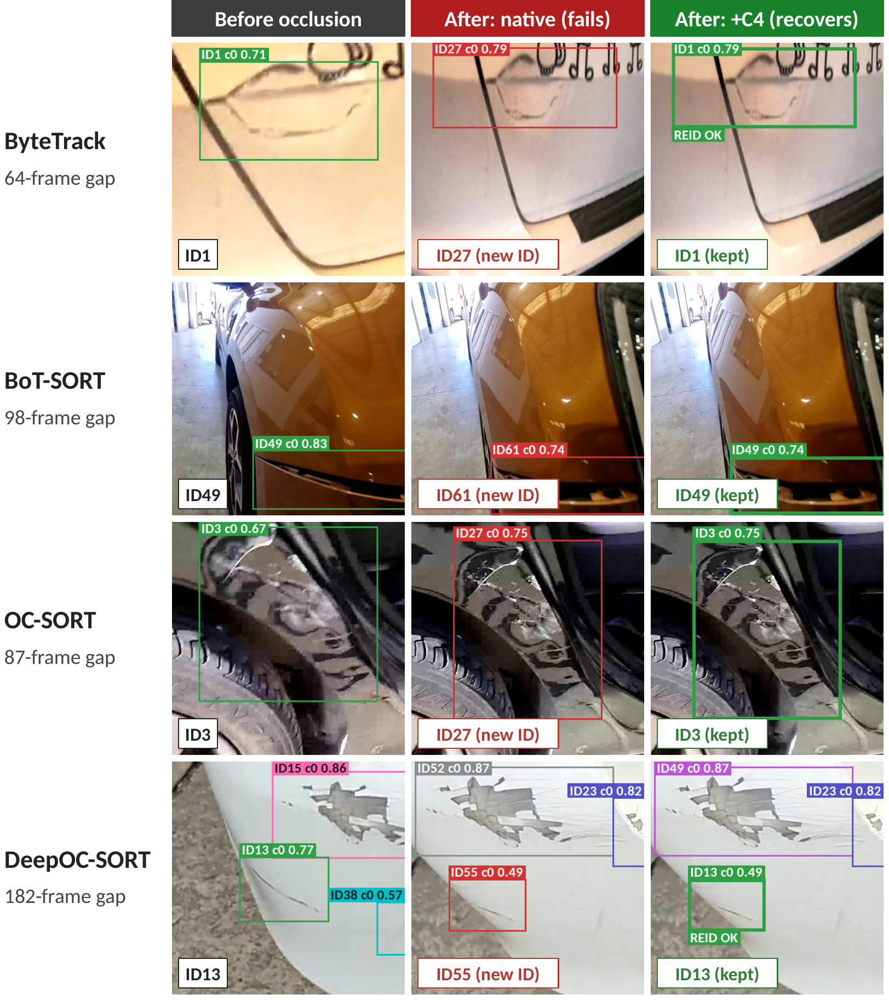

# Reusing frozen detector encoder features for occlusion-robust re-identification in vehicle damage tracking

Code for the paper. A vehicle-inspection video is tracked damage by damage, and
when a damage is occluded and reappears, standard trackers often give it a new
identity. We show that a **frozen intermediate feature map of the detector's own
encoder (C4, RT-DETR)** is enough to recover the correct identity, with **no
training, no extra parameters and under 0.6 ms per re-identification event**.



## Contributions

1. **Semi-supervised annotation pipeline.** A pre-trained detector proposes
   video-level pseudo-trajectories that annotators verify and correct; it extends
   the TVDT dataset with 55 new videos.
2. **Gap-isolated re-identification metric.** Measures, separately from
   frame-to-frame association (HOTA/IDF1), whether a tracker recovers the correct
   identity after an occlusion (gaps of at least 3 frames, classified as
   re-identified / id swap / new id born / unevaluated).
3. **Training-free re-identification module.** When the tracker is about to create
   a new ID, the new crop is compared (cosine similarity, Hungarian assignment,
   threshold tau) with a gallery of recently lost identities (retained up to 200
   frames), using C4 features pooled with RoIAlign from the detector's encoder.

The module is plug-in for ByteTrack, BoT-SORT, OC-SORT and DeepOC-SORT.

## Main results

Evaluation protocol: the detector was adapted with frames from 10 of the 72
sequences, so **those 10 are excluded from every evaluation**: live results use
62 sequences, the offline k-fold identity-accuracy comparison uses 54 (the 62
minus the 8 validation sequences used for tracker hyperparameters).

Live end-to-end tracking, 62 sequences (IDF1 / identity switches):

| Tracker | Native IDF1 | + C4 IDF1 | Native IDSW | + C4 IDSW |
|---|---|---|---|---|
| ByteTrack | 51.41 | 55.09 | 451 | 386 |
| BoT-SORT | 52.55 | 53.90 | 414 | 412 |
| OC-SORT | 57.37 | 61.00 | 340 | 179 |
| DeepOC-SORT | 56.18 | 61.69 | 314 | 164 |

C4 is compared with OSNet (MSMT17), CLIP-VehicleID, DINOv2 and P4-FPN in the
paper; all numbers, confidence intervals and McNemar tests are in the Results and
Ablation sections.

Gap-level identity accuracy rises from 23.5-36.4 % (native trackers) to
80.0-94.1 % with the module. Note that the native re-identification rate is
reported under three different protocols (post-hoc, train+test only, live) and
rates should only be compared within a protocol.

## Dataset

72 evaluated vehicle-inspection sequences (17 from the original 360-degree set and
55 recorded by end users), 400 annotated trajectories, 77,034 annotated boxes,
about 47.5k frames, six resolutions, 66 landscape / 6 portrait, 30 fps. Split into 56
train / 8 validation / 8 test sequences. All visible license plates are
anonymized. The train/validation/test labels describe annotation and tuning roles,
not an exclusion from evaluation, since the module has no trainable parameters.

### Dataset access

The dataset (annotated video sequences and ground-truth trajectories) is not
stored in this repository because of its size. It is available on request:
**[request form](https://forms.gle/JLJxYTrnbX8A6tUc9)**.

## Repository layout

| Path | Contents |
|---|---|
| `live_tracking/` | Live pipeline: `run_eval_nodedup.py` (tracking + TrackEval evaluation), `main_track_nodedup.py` (trackers + module hook), `reid_gallery.py` (gallery: `bury`, `match_newborns`, ageing/pruning), `custom_reid.py` (C4 / P4-FPN / DINOv2 / OSNet / CLIP encoders), `trackeval_api.py`, `run_live_experiments.sh` (the paper's configurations) |
| `infer_track_reid_gaps.py`, `analyze_reid_gap_failures.py` | Gap-isolated metric: detection and classification of occlusion gaps |
| `kfold_utils.py`, `compare_kfold_cases.py`, `pool_existing_kfold_results.py` | Offline k-fold identity-accuracy comparison and McNemar tests |
| `analyze_dinov2_*.py`, `embedding_analysis_dinov2_vs_p4.py`, `plot_*_crops_*.py` | Embedding analysis (compression, PCA, isotropy) |
| `linear_reid_head.py`, `train_linear_reid_head.py`, `set_reid_model.py`, `train_track_query_reid.py` | Optional trained heads (H1-H4), reported as a separate ablation |
| `paper_fig_*.py` | Scripts that generate paper figures |
| `exp_*` | Detector-provenance experiments (no-video detectors, test_models sweep) and the exclusion of the 10 seen sequences |
| `legacy/` | Earlier diagnostics and example-search scripts, not needed to reproduce the paper |
| `docs/EXPERIMENT_LOG.md` | Chronological experiment log (run-by-run, in Spanish) |

## Reproducing the live evaluation

Requirements: Python 3.10 and the packages in `requirements.txt` (the versions of
the environment used for the paper, including `boxmot==21.0.0`), plus an RT-DETR
checkpoint and config (from the RT-DETR repository, which also provides the `src`
package) and [TrackEval](https://github.com/JonathonLuiten/TrackEval) (set
`TRACKEVAL_DIR` to its folder).

```bash
pip install -r requirements.txt   # install PyTorch first for your CUDA version, see the file header
```

```bash
export DETECTOR_PTH=<detector.pth> DETECTOR_CFG=<rtdetrv2_r101vd_6x_coco.yml>
export DATA_ROOT=<dataset> GT_ROOT=<dataset_gt>

live_tracking/run_live_experiments.sh native botsort out/native_botsort   # native tracker
live_tracking/run_live_experiments.sh c4     botsort out/c4_botsort       # tracker + C4 module
```

`<method>` is `native`, `c4`, `p4fpn`, `dinov2`, `osnet` or `clip`; `<tracker>` is
`bytetrack`, `botsort`, `ocsort` or `deepocsort`. The script sets, per tracker,
the hyperparameters used in the paper and, per signal, its similarity threshold
tau (C4 0.9405, P4-FPN 0.7981, DINOv2 0.6919, OSNet 0.8000, CLIP-VehicleID
0.7698), all calibrated without the 10 detector-seen sequences. The gallery keeps
lost identities for up to 200 frames. Metrics (HOTA, MOTA, IDF1, IDSW) are computed
with TrackEval; the 62 evaluation sequences are selected when scoring
(`exp_exclude_seen/`).

Sequences are evaluated one process at a time (8 GB GPU suffices).
`run_eval_nodedup.py` logs per-sequence errors without failing, so check the log
for `[ERROR]` lines and count the output files.

## Implementation note

The `*_nodedup` files keep both boxes when two tracks end up with the same final
ID in a frame and give the colliding track a new ID; an earlier version dropped
one of them, which understated identity switches. All numbers in the paper use
the corrected version.

## License

- **Code:** [MIT](LICENSE).
- **Dataset:** [CC BY-NC 4.0](https://creativecommons.org/licenses/by-nc/4.0/). It can be used for academic research free of charge, citing the paper below. If you seek to use the data for commercial purposes, please contact us.

## Citation

If you use the code or the dataset, please cite the paper. Citation details will be added upon publication.
